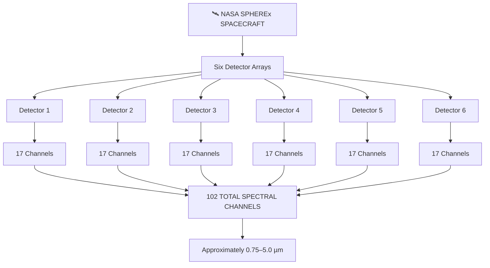
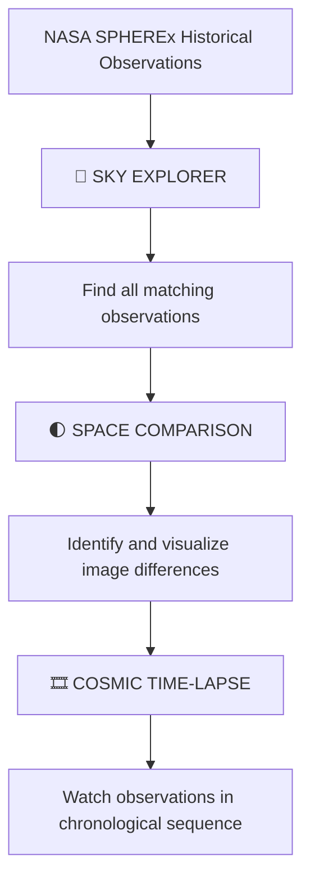
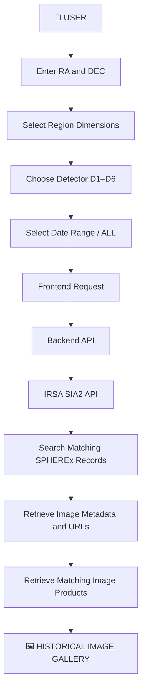
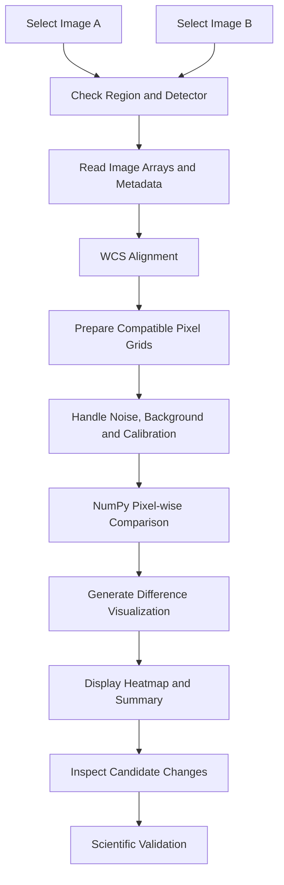
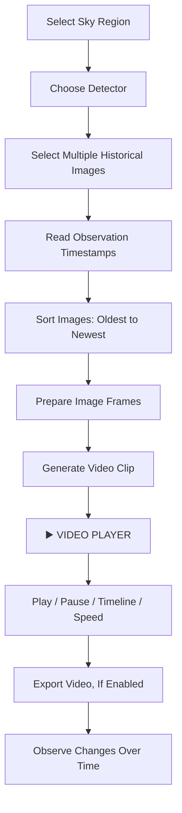
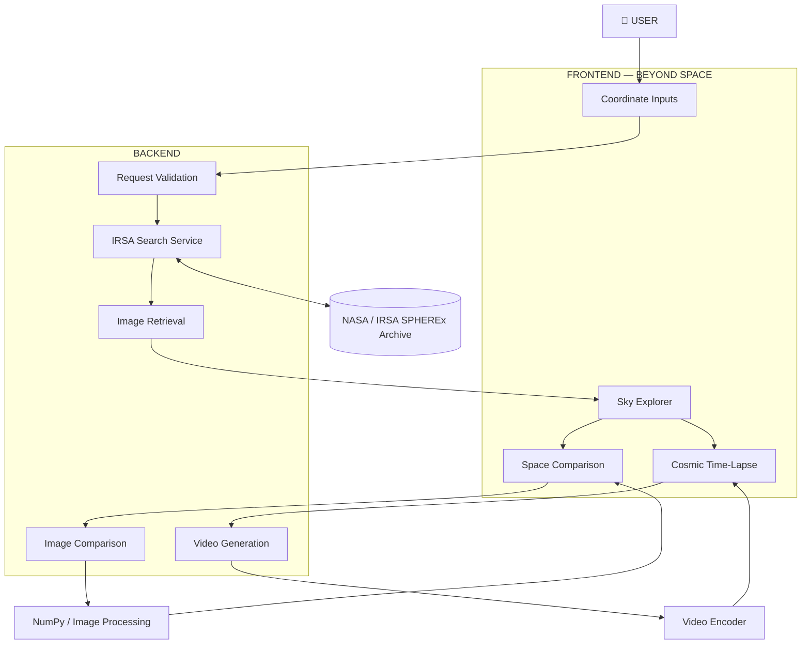

<div align="center">

# 🌌 BEYOND SPACE

### Explore the Universe. Discover What Lies Beyond.

**An interactive platform to explore, compare, and visualize historical NASA SPHEREx infrared observations.**


**Team InnoVerse | NASA Space Apps Challenge**

</div>

---

# 🚀 1. ABOUT THE PROJECT

Spacecraft and space observatories continuously collect enormous amounts of scientific data about our universe.

NASA's **SPHEREx (Spectro-Photometer for the History of the Universe, Epoch of Reionization and Ices Explorer)** mission observes the entire sky in infrared wavelengths and produces millions of scientific image products.

The same region of the sky can be observed repeatedly at different times and across different wavelength ranges.

However, finding historical observations, opening individual images, comparing them manually, and identifying changes over time can be difficult.

**BEYOND SPACE transforms this process into an interactive experience.**

It connects users with NASA SPHEREx observations available through the **Caltech/IPAC Infrared Processing and Analysis Center (IRSA)** archive.

Our application provides three major features:

| Feature | Purpose |
|---|---|
| 🔭 **Sky Explorer** | Discover historical observations of a selected sky region. |
| 🌓 **Space Comparison** | Compare two observations and visualize their differences. |
| 🎞️ **Cosmic Time-Lapse** | Convert multiple observations into a chronological video. |

> **Our vision: Instead of manually exploring thousands of individual images, users can discover, compare, and watch how a region of the universe changes over time.**

---

# 🛰️ 2. UNDERSTANDING NASA SPHEREx

SPHEREx is a NASA infrared space telescope designed to survey the entire sky and collect spectral information about the universe.

## 📊 SPHEREx — By the Numbers

<div align="center">

<table>
<tr>
<td align="center">

# 6

**DETECTOR ARRAYS**

</td>
<td align="center">

# 17

**CHANNELS PER DETECTOR**

</td>
<td align="center">

# 102

**TOTAL SPECTRAL CHANNELS**

</td>
</tr>
<tr>
<td align="center">

# 0.75–5.0

**WAVELENGTH (µm)**

</td>
<td align="center">

# ~6 MONTHS

**FULL-SKY SURVEY CADENCE**

</td>
<td align="center">

# ~2 YEARS

**PLANNED PRIMARY MISSION**

</td>
</tr>
</table>

</div>

## 🔬 How does SPHEREx collect 102 spectral channels?

SPHEREx contains **six detector arrays**.

Each detector is associated with a **Linear Variable Filter (LVF)**. The wavelength response of this filter changes across the detector surface.

Each detector contributes 17 nominal spectral channels.

<div align="center">



</div>

### What does this mean?

- **6 detectors** collect infrared measurements through their respective optical/filter paths.
- Each detector contributes **17 nominal spectral channels**.
- Together, they provide **102 spectral channels**.
- Repeated scanning and overlapping observations build up the full-sky spectral coverage.

**Important:** These are not 102 independent cameras. The LVF produces wavelength-dependent measurements across detector positions, and the scanning strategy builds the spectral survey.

## 🌍 How frequently is the entire sky observed?

SPHEREx scans the sky in overlapping strips.

As the observing geometry changes, the telescope gradually covers the entire sky.

- Approximately one full-sky survey every **six months**.
- Approximately **four full-sky surveys** during the planned two-year primary mission.

This repeated coverage makes historical observations valuable for investigating how the observed sky differs over time.

## 📦 How much data is available?

According to the SPHEREx Data Release 1 documentation:

<div align="center">

| DATA STATISTIC | VALUE |
|---|---:|
| Individual input images used in DR1 all-sky cube construction | **1.2+ MILLION** |
| All-sky cube tiles | **12,288** |
| Spectral channels per cube | **102** |
| Spatial dimensions per cited cube tile | **512 × 512 pixels** |

</div>

These figures describe the documented **DR1 all-sky cube products**.

The 1.2+ million figure refers to input images used to construct those cubes. It is not a live count of every image ever collected by SPHEREx, nor does it represent the number of images returned by every search in BEYOND SPACE.

The actual number of observations available for a particular search depends on the selected sky region, detector, archive collection, and data release.

---

# ⚠️ 3. THE PROBLEM

Space missions collect massive amounts of scientific observations, but exploring those observations manually is challenging.

### Traditional approach

- Search for individual observations.
- Open images one by one.
- Switch between different observation dates.
- Remember the differences between images.
- Manually arrange images to understand changes over time.

### Why is this difficult?

| Problem | Impact |
|---|---|
| Huge image archives | Difficult to locate relevant observations |
| Multiple observations of the same region | Repetitive manual searching |
| Individual image inspection | Subtle differences can be overlooked |
| Manual image comparison | Time-consuming |
| Manual chronological arrangement | Difficult to understand temporal changes |

## 💡 Our solution

BEYOND SPACE combines three capabilities into one application.

<div align="center">



</div>

**DISCOVER → INVESTIGATE → VISUALIZE**

---

# 🔭 4. FEATURE ONE — SKY EXPLORER

### Explore the universe, region by region.

Sky Explorer allows users to select a specific region of the sky and retrieve its available historical SPHEREx observations.

## User inputs

| Input | Description |
|---|---|
| Right Ascension (RA) | Celestial longitude |
| Declination (DEC) | Celestial latitude |
| Region dimensions | Defines the selected sky area |
| Detector | D1, D2, D3, D4, D5, or D6 |
| Date filter | Specific date range or all available dates |

## How does it work?

<div align="center">



</div>

## Technology behind Sky Explorer

**IRSA — Infrared Science Archive**

IRSA hosts public SPHEREx data products.

**SIA2 — Simple Image Access Version 2**

The SIA2 API allows the backend to search image records using sky-position and other supported constraints.

**Backend processing**

1. Receives the coordinates, dimensions, detector and date filter.
2. Constructs the archive query.
3. Sends the request to IRSA SIA2.
4. Receives matching records and metadata.
5. Retrieves the matching image products or cutouts.
6. Sends the results to the frontend.

## What does the user see?

- Actual astronomical image previews.
- Observation date and time.
- Observation ID.
- Detector information.
- Available wavelength/channel metadata.
- Image access or download options where supported.

**ALL AVAILABLE DATES:** Retrieves matching observations for the selected sky region and detector. It does not automatically include all six detectors.

## 📸 SKY EXPLORER — APPLICATION SCREENSHOT

<div align="center">

<!-- Replace the image path with your actual screenshot -->


**Figure 1 — Sky Explorer interface**

</div>

---

# 🌓 5. FEATURE TWO — SPACE COMPARISON

### Discover what changed in the universe.

Space Comparison allows users to select two observations of the same sky region and investigate their differences.

## User workflow

1. Select a region and detector.
2. Select an earlier image — **Image A**.
3. Select a later image — **Image B**.
4. Run the comparison.
5. View the difference visualization.

## How does image comparison work?

Astronomical images should not be compared by blindly subtracting raw pixel values.

Before comparison, the images should be prepared appropriately.

| Processing | Purpose |
|---|---|
| WCS alignment | Aligns corresponding sky positions |
| Pixel-grid compatibility | Ensures compatible image dimensions and scale |
| Calibration | Helps account for instrumental effects |
| Background handling | Reduces background-related differences |
| Noise and bad-pixel handling | Prevents unreliable pixels from dominating |
| NumPy | Performs numerical array comparisons |

## NumPy image comparison

NumPy works with image data represented as numerical arrays.

A simple pixel-wise difference can be represented as:

```python
difference = image_b - image_a
```

This operation should only be performed after appropriate image alignment and preprocessing.

NumPy calculates numerical differences; it does not independently identify astronomical objects.

## What does the comparison window display?

- Image A and Image B side by side.
- Overlay comparison.
- Difference heatmap.
- Brightness increase or decrease indicators.
- Candidate source appearance or disappearance.
- Possible positional variation.
- Numerical difference summaries.

## 📊 Comparison workflow

<div align="center">



</div>

## Probability and confidence

A numerical difference score does not automatically represent the probability of an astronomical event.

A scientifically meaningful probability requires a documented statistical model, uncertainty estimates, and validation.

If the application does not implement such a model, the output should be described as a **difference score or candidate change**, rather than a confirmed event probability.

## 📸 SPACE COMPARISON — APPLICATION SCREENSHOTS

<div align="center">

<!-- Replace with your actual screenshot -->


**Figure 2 — Image comparison interface**

<br><br>


**Figure 3 — Difference heatmap visualization**

</div>

---

# 🎞️ 6. FEATURE THREE — COSMIC TIME-LAPSE

### Watch the universe change over time.

Instead of manually opening every historical image, users can select multiple observations and generate a chronological video.

The selected images are arranged according to their actual observation timestamps.

## How does it work?

<div align="center">



</div>

## What does the video demonstrate?

The video displays the same selected region through multiple observation dates.

By watching the sequence, users may more easily notice:

- Changes in brightness.
- A source becoming visible or less visible.
- Possible changes in the apparent position of an object.
- Changes in the structure of the observed region.

## Video player features

| Control | Purpose |
|---|---|
| ▶️ Play / Pause | Start or stop playback |
| ⏮️ Previous / Next | Move between frames |
| Timeline | Track video progress |
| Playback speed | Adjust video speed |
| Observation date | Display the current frame's date |
| MP4 export | Save the generated video, if implemented |

## Why is this useful?

**Traditional method:** Open Image 1 → Open Image 2 → Open Image 3 → Manually compare.

**BEYOND SPACE:** Select images → Automatically arrange by date → Generate one video → Watch the changes.

The video must use actual selected observations as its scientific frames. Any interpolated transitions must be clearly identified as generated transitions, not real SPHEREx exposures.

Apparent changes still require scientific validation to rule out noise, calibration and alignment effects.

## 📸 COSMIC TIME-LAPSE — APPLICATION SCREENSHOTS

<div align="center">

<!-- Replace with your actual screenshot -->


**Figure 4 — Video generation interface**

<br><br>


**Figure 5 — Generated video player**

</div>

---

# 🎬 7. COMPLETE APPLICATION DEMONSTRATION

### Watch how BEYOND SPACE works.

Add a recorded video walkthrough of your application here.

Your video can demonstrate:

1. Opening the application.
2. Selecting RA, DEC and region dimensions.
3. Choosing a detector.
4. Retrieving historical observations through IRSA.
5. Selecting two images for comparison.
6. Viewing the difference heatmap.
7. Selecting multiple observations.
8. Generating and playing the chronological video.

## 🎥 Application demo

<div align="center">

<!-- Add your demo GIF here -->


**BEYOND SPACE — Complete Application Walkthrough**

[▶ WATCH THE FULL VIDEO DEMONSTRATION](assets/demo/beyond-space-demo.mp4)

</div>

**To add your video:**

Save your files in:

```text
assets/
└── demo/
    ├── beyond-space-demo.mp4
    └── beyond-space-preview.gif
```

GitHub's README video preview behavior may vary. The MP4 link provides a fallback if inline playback is unavailable.

---

# 🧰 8. TECHNOLOGY STACK

| Technology | Purpose |
|---|---|
| Frontend framework | User interface and interactive components |
| Backend framework | Handles API requests and processing |
| NASA SPHEREx / IRSA | Source of astronomical observations |
| IRSA SIA2 API | Retrieves matching archive records |
| NumPy | Image-array calculations and pixel differences |
| Astropy / FITS tools, if integrated | Reads astronomical image data and metadata |
| WCS tools, if integrated | Supports sky-coordinate image alignment |
| OpenCV / FFmpeg, if integrated | Creates chronological videos |
| GitHub | Source-code management |
| Google AI Studio | Application development environment |

## System architecture

<div align="center">



</div>

---

# 📁 9. PROJECT STRUCTURE

Suggested structure for screenshots and demo assets:

```text
beyond-space/
│
├── README.md
│
├── assets/
│   ├── screenshots/
│   │   ├── sky-explorer.png
│   │   ├── comparison-window.png
│   │   ├── difference-heatmap.png
│   │   ├── video-generation.png
│   │   └── video-player.png
│   │
│   └── demo/
│       ├── beyond-space-demo.mp4
│       └── beyond-space-preview.gif
│
├── frontend/
├── backend/
└── configuration files
```

The frontend and backend folders above are illustrative. Your actual repository structure may be different.

---

# 🧪 10. SCIENTIFIC ACCURACY AND LIMITATIONS

BEYOND SPACE is an exploration and visualization tool. Every image difference should not automatically be treated as an astronomical discovery.

Important considerations:

- Noise can create apparent brightness differences.
- Background variations can affect pixel values.
- Imperfect image alignment can create false positional shifts.
- Calibration and exposure differences can affect comparisons.
- Different wavelength responses can change how an object appears.
- Candidate changes require further scientific investigation.
- Probability values must be backed by a validated statistical method.

The application aims to make observations easier to explore and investigate, not replace scientific verification.

---

# 🌐 11. NASA AND IRSA REFERENCES

- [NASA SPHEREx Mission](https://science.nasa.gov/mission/spherex/)
- [NASA JPL SPHEREx](https://www.jpl.nasa.gov/missions/spherex/)
- [SPHEREx Data Products](https://spherex.caltech.edu/page/data-products)
- [IRSA SPHEREx Data Release 1](https://irsa.ipac.caltech.edu/data/SPHEREx/docs/overview_dr1.html)
- [IRSA SPHEREx Archive Documentation](https://irsa.ipac.caltech.edu/spherex-archive-documentation/)
- [IRSA SPHEREx Data Access](https://irsa.ipac.caltech.edu/spherex-archive-documentation/spherex-data-access/)
- [IRSA Image API Documentation](https://irsa.ipac.caltech.edu/docs/program_interface/api_images.html)
- [SPHEREx Explanatory Supplement](https://irsa.ipac.caltech.edu/data/SPHEREx/docs/SPHEREx_Expsupp.pdf)

---

# 🏆 12. OUR VISION

<div align="center">

## 🔭 DISCOVER
### Explore historical observations with Sky Explorer.

⬇️

## 🌓 INVESTIGATE
### Compare images and identify candidate differences.

⬇️

## 🎞️ VISUALIZE
### Watch observations evolve through Cosmic Time-Lapse.

---

# 🌌 BEYOND SPACE

### FROM INDIVIDUAL OBSERVATIONS TO A MOVING STORY OF THE UNIVERSE.

**Explore the Universe. Discover What Lies Beyond.**

**Team InnoVerse**

*NASA Space Apps Challenge*

</div>
